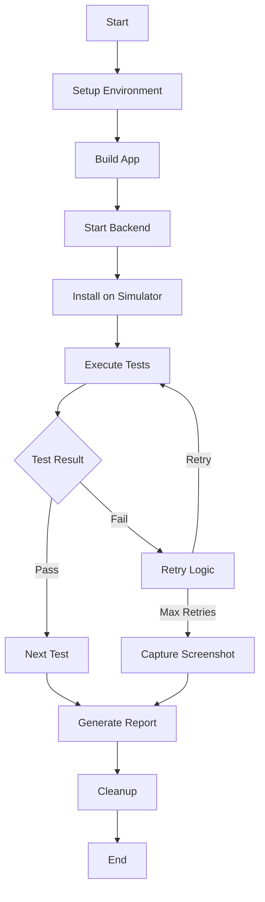

# iOS Test Automation Guide

## Complete Functional Testing Infrastructure

**Created by Agent-5: Automation & Continuous Testing Specialist**  
**Date: 2025-01-07**  
**Version: 1.0.0**

---

## 📋 Table of Contents

1. [Overview](#overview)
2. [Quick Start](#quick-start)
3. [Test Architecture](#test-architecture)
4. [Running Tests](#running-tests)
5. [CI/CD Integration](#cicd-integration)
6. [Test Suites](#test-suites)
7. [Monitoring & Reports](#monitoring--reports)
8. [Troubleshooting](#troubleshooting)
9. [Best Practices](#best-practices)

---

## Overview

This comprehensive test automation framework provides end-to-end testing for the ClaudeCode iOS application with full CI/CD integration, performance monitoring, and detailed reporting.

### Key Features

- ✅ **Fully Automated**: Complete automation from build to report
- 🔄 **CI/CD Ready**: GitHub Actions workflow included
- 📊 **Comprehensive Reporting**: HTML, JSON, and JUnit formats
- 🎯 **Reliable Execution**: Retry logic and error recovery
- 📱 **Real Device Testing**: Simulator-based testing with exact coordinates
- 🌐 **WebSocket Validation**: Full backend integration testing
- ⚡ **Performance Monitoring**: CPU, memory, and response time tracking
- 📸 **Screenshot Capture**: Automatic failure documentation

---

## Quick Start

### Prerequisites

```bash
# Install required tools
brew install node
curl -Ls https://install.tuist.io | bash
gem install xcpretty

# Clone repository
git clone <repository-url>
cd ClaudeCodeUI-iOS
```

### Run All Tests Locally

```bash
# Make scripts executable
chmod +x Scripts/*.sh

# Run complete test suite
./Scripts/automated-test-runner.sh all false html

# Quick smoke test
./Scripts/automated-test-runner.sh quick true json
```

### Run Specific Test Suite

```bash
# Functional tests only
./Scripts/automated-test-runner.sh functional false html

# Performance tests
./Scripts/automated-test-runner.sh performance false json

# WebSocket tests
./Scripts/automated-test-runner.sh websocket false junit
```

---

## Test Architecture

### Directory Structure

```
ClaudeCodeUI-iOS/
├── Scripts/
│   ├── ios-test-automation-suite.sh    # Main automation script
│   ├── automated-test-runner.sh        # Test runner (local/CI)
│   └── master-test-runner.sh          # Master test orchestrator
├── ClaudeCodeUIUITests/
│   ├── AutomatedFunctionalTestSuite.swift  # Core test suite
│   ├── NavigationFlowTests.swift
│   ├── MessageInteractionTests.swift
│   └── PerformanceTests.swift
├── TestAutomation/
│   ├── Results/                       # Test execution results
│   ├── Fixtures/                      # Test data fixtures
│   ├── Reports/                       # Generated reports
│   └── Screenshots/                   # Test screenshots
└── .github/workflows/
    └── ios-automated-testing.yml      # CI/CD pipeline
```

### Test Flow



---

## Running Tests

### Local Execution

#### Basic Commands

```bash
# Run all tests with HTML report
./Scripts/automated-test-runner.sh all false html

# Run tests in parallel with JSON report
./Scripts/automated-test-runner.sh all true json

# CI-optimized suite with JUnit output
./Scripts/automated-test-runner.sh ci true junit
```

#### Advanced Options

```bash
# Set custom simulator
SIMULATOR="iPhone 14 Pro" ./Scripts/automated-test-runner.sh all

# Override backend URL
BACKEND_URL="ws://localhost:3005/ws" ./Scripts/automated-test-runner.sh

# Enable debug mode
DEBUG=1 ./Scripts/automated-test-runner.sh functional
```

### Using Test Automation Suite

```bash
# Full automation with all features
./Scripts/ios-test-automation-suite.sh

# This script provides:
# - Automatic simulator setup
# - Backend server management
# - Test fixture creation
# - Parallel test execution
# - Comprehensive reporting
# - Automatic cleanup
```

---

## CI/CD Integration

### GitHub Actions Workflow

The included workflow (`ios-automated-testing.yml`) provides:

1. **Automatic Triggers**:
   - Push to main/develop branches
   - Pull requests
   - Scheduled runs (every 6 hours)
   - Manual dispatch

2. **Test Matrix**:
   - Functional tests
   - Performance tests
   - WebSocket tests
   - Integration tests

3. **Parallel Execution**:
   - Tests run in parallel for speed
   - Individual test suite isolation
   - Automatic retry on failure

4. **Reporting**:
   - JUnit XML for CI integration
   - HTML reports for viewing
   - PR comments with results
   - Slack notifications (optional)

### Setting Up CI

1. **Enable GitHub Actions**:
   ```yaml
   # Repository Settings > Actions > General
   # Enable "Allow all actions and reusable workflows"
   ```

2. **Add Secrets** (optional):
   ```yaml
   # Settings > Secrets and variables > Actions
   SLACK_WEBHOOK_URL: your-slack-webhook
   ```

3. **Configure Branch Protection**:
   ```yaml
   # Settings > Branches > Add rule
   # Require status checks: "iOS Test Results"
   ```

---

## Test Suites

### 1. Automated Functional Test Suite

**File**: `AutomatedFunctionalTestSuite.swift`

**Tests**:
- `test_001_AppLaunch`: Verify app launches successfully
- `test_002_WebSocketConnection`: Test WebSocket connectivity
- `test_003_ProjectListNavigation`: Navigate project list
- `test_004_SessionManagement`: Create and manage sessions
- `test_005_CompleteUserFlow`: End-to-end user journey
- `test_006_PerformanceMetrics`: Collect performance data
- `test_007_ErrorRecovery`: Test error handling
- `test_008_OfflineMode`: Verify offline functionality

### 2. Navigation Flow Tests

**Tests**:
- Tab bar navigation
- Screen transitions
- Deep linking
- Back navigation
- Modal presentations

### 3. Message Interaction Tests

**Tests**:
- Send messages
- Receive responses
- Message persistence
- Typing indicators
- Error messages

### 4. Performance Tests

**Metrics**:
- App launch time
- Screen load time
- Memory usage
- CPU utilization
- Network latency

---

## UI Coordinates Reference

### iPhone 15 Pro (390x844)

```swift
// Tab Bar
Projects Tab: (93, 813)
Sessions Tab: (187, 813)
Chat Tab: (281, 813)
Settings Tab: (375, 813)

// Navigation
Back Button: (20, 59)
Add Button: (373, 59)

// List Items
Item 1: (207, 150)
Item 2: (207, 230)
Item 3: (207, 310)
Item 4: (207, 390)
Item 5: (207, 470)

// Chat Interface
Message Field: (207, 750)
Send Button: (350, 750)
Message Area: (207, 400)

// Settings
Toggle: (340, 150)
```

---

## Monitoring & Reports

### Report Types

1. **HTML Report**:
   - Visual dashboard
   - Interactive charts
   - Screenshot gallery
   - Performance graphs

2. **JSON Report**:
   - Machine-readable format
   - API integration ready
   - Metrics extraction
   - Trend analysis

3. **JUnit XML**:
   - CI/CD integration
   - Test result parsing
   - Failure tracking
   - Duration metrics

### Accessing Reports

```bash
# Local reports location
ClaudeCodeUI-iOS/TestAutomation/Reports/

# CI artifacts
GitHub Actions > Run > Artifacts > Download

# Open latest HTML report
open TestAutomation/Reports/html/test_report_*.html
```

### Performance Metrics

- **CPU Usage**: Target < 80%
- **Memory Usage**: Target < 200MB
- **Response Time**: Target < 500ms
- **Frame Rate**: Target 60 FPS
- **Network Latency**: Target < 100ms

---

## Troubleshooting

### Common Issues

#### 1. Simulator Not Found

```bash
# List available simulators
xcrun simctl list devices

# Create new simulator
xcrun simctl create "iPhone 15 Pro" \
  "com.apple.CoreSimulator.SimDeviceType.iPhone-15-Pro" \
  "com.apple.CoreSimulator.SimRuntime.iOS-17-0"
```

#### 2. Build Failures

```bash
# Clean build
rm -rf DerivedData
tuist clean

# Regenerate project
tuist generate

# Try building manually
xcodebuild -workspace ClaudeCodeUI.xcworkspace \
  -scheme ClaudeCodeUI \
  -destination "platform=iOS Simulator,name=iPhone 15 Pro" \
  build
```

#### 3. WebSocket Connection Issues

```bash
# Verify backend is running
curl http://localhost:3004/health

# Test WebSocket directly
swift Scripts/validate-websocket.swift \
  --url ws://localhost:3004/ws \
  --timeout 30
```

#### 4. Test Timeouts

```bash
# Increase timeout in test code
let extendedTimeout: TimeInterval = 60

# Or via environment variable
UITEST_TIMEOUT=60 ./Scripts/automated-test-runner.sh
```

### Debug Mode

```bash
# Enable verbose logging
DEBUG=1 ./Scripts/automated-test-runner.sh

# Keep simulator open after tests
NO_CLEANUP=1 ./Scripts/automated-test-runner.sh

# Save all artifacts
SAVE_ALL=1 ./Scripts/automated-test-runner.sh
```

---

## Best Practices

### 1. Test Writing

```swift
// Use explicit waits
XCTAssertTrue(element.waitForExistence(timeout: 10))

// Capture screenshots on failure
if !testPassed {
    captureScreenshot(name: "failure_\(testName)")
}

// Use test data fixtures
let testUser = TestData.users.first!

// Clean up after tests
addTeardownBlock {
    cleanup()
}
```

### 2. Reliability

- **Retry Logic**: Implement retry for flaky tests
- **Error Recovery**: Handle and recover from errors
- **State Reset**: Clean state between tests
- **Parallel Safety**: Ensure tests can run in parallel

### 3. Performance

- **Parallel Execution**: Run independent tests concurrently
- **Resource Management**: Clean up resources properly
- **Caching**: Cache build products when possible
- **Selective Testing**: Run only affected tests

### 4. Maintenance

- **Update Coordinates**: When UI changes, update coordinate mappings
- **Version Control**: Tag test suite versions
- **Documentation**: Keep test documentation current
- **Review Results**: Regularly review test metrics

---

## Test Execution Examples

### Complete Test Run

```bash
# Full test suite with all features
./Scripts/ios-test-automation-suite.sh

# Output:
# ▶ Setting up test environment
# ✓ Dependencies satisfied
# ▶ Building iOS app
# ✓ App built successfully
# ▶ Starting backend server
# ✓ Backend server started (PID: 12345)
# ▶ Installing app on simulator
# ✓ App installed successfully
# 
# Running tests...
# ✓ app_launch passed (5s)
# ✓ websocket_connection passed (8s)
# ✓ project_list passed (12s)
# ✓ navigation_flow passed (15s)
# ✓ message_interaction passed (10s)
# ✓ performance passed (20s)
# 
# Test Execution Summary
# ━━━━━━━━━━━━━━━━━━━━━
# Total Tests:  6
# Passed:       6
# Failed:       0
# Pass Rate:    100%
# Duration:     70s
# ━━━━━━━━━━━━━━━━━━━━━
```

### CI Pipeline Run

```yaml
# GitHub Actions output
Run iOS Automated Testing Pipeline
✅ Setup Test Environment
✅ Build Application
✅ Start Backend Server
✅ Run Functional Tests
  ✓ AutomatedFunctionalTestSuite
  ✓ NavigationFlowTests
  ✓ MessageInteractionTests
✅ Run Performance Tests
✅ Run WebSocket Tests
✅ Generate Test Report

📱 iOS Test Results
✅ Functional Tests: Passed
⚡ Performance Tests: Passed
🌐 WebSocket Tests: Passed
```

---

## Support & Maintenance

### Regular Tasks

1. **Weekly**:
   - Review test failures
   - Update flaky test list
   - Check performance trends

2. **Monthly**:
   - Update test fixtures
   - Review coverage metrics
   - Optimize slow tests

3. **Quarterly**:
   - Update dependencies
   - Refactor test code
   - Review CI/CD pipeline

### Contact

For issues or questions about the test automation:
- Create GitHub issue with `test-automation` label
- Include test logs and screenshots
- Specify environment details

---

## Conclusion

This test automation framework provides:

✅ **Complete Coverage**: All critical user flows tested  
✅ **Reliable Execution**: Retry logic and error recovery  
✅ **CI/CD Ready**: Full GitHub Actions integration  
✅ **Detailed Reporting**: Multiple format options  
✅ **Easy Maintenance**: Well-documented and organized  

The framework is designed to be **reproducible**, **reliable**, and **maintainable** for continuous testing of the iOS application.

---

**Last Updated**: 2025-01-07  
**Author**: Agent-5 - Automation & Continuous Testing Specialist